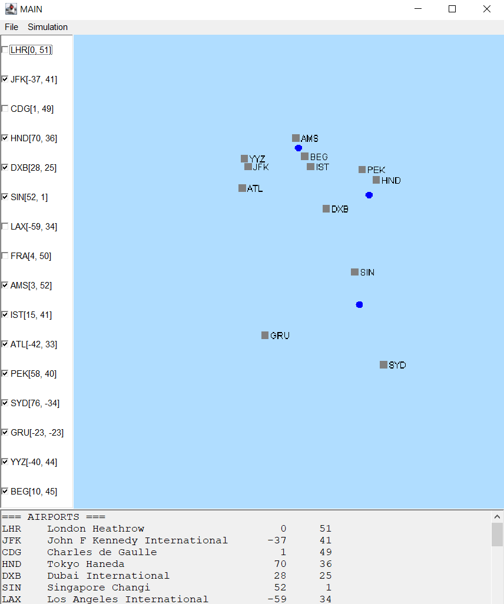

# Airports Simulator

A Java desktop application that simulates air traffic between airports, with a GUI that shows airports and flights on a 2D map in real time. Built for the Object-Oriented Programming 2 course at the School of Electrical Engineering (ETF), University of Belgrade.



## Features

**Data entry and storage**
- Add airports (name, unique 3-letter uppercase code, x/y coordinates) and flights (origin, destination, departure time, duration in minutes)
- Data is shown in tables
- Save and load data as **CSV** or **JSON**
- Input validation with specific error messages (invalid coordinates, duplicate airport code, wrong time format, missing file, malformed file)
- Automatic shutdown after 60 seconds of inactivity, with a warning dialog and a countdown in the last 5 seconds

**Map visualization**
- Airports appear as gray squares at their coordinates, labeled with their code
- Click an airport to select it (it blinks red), and click again to deselect
- A side list with checkboxes controls which airports are visible on the map
- The inactivity timer pauses while an airport is selected

**Flight simulation**
- 1 real second equals 10 simulated minutes, starting at 00:00
- Each airport allows at most one takeoff per 10 simulated minutes, and other flights wait in a queue
- Planes are blue circles moving in a straight line at constant speed, updated every 200 ms
- Start, pause and reset controls
- The inactivity timer is paused during the simulation

## Tech Stack
- Java 21
- AWT
- Multithreading and timers

## Architecture
The code separates the data model, application logic and presentation:
- **Model**: airports, flights and system data (`SystemData`)
- **File I/O**: `CSVParser` and `JSONParser` for loading and saving data
- **GUI**: `MapPanel` handles map drawing and coordinate mapping, delegating to `AirportRenderer` and `FlightRenderer`
- **Simulation**: runs on its own thread, with shared state protected using `AtomicInteger` and `synchronized`

## Getting Started
```bash
git clone https://github.com/[username]/[repo-name].git
cd [repo-name]
[build and run command / main class]
```

## What I Learned
- Designing a layered application with a clear split between model, logic and view
- Multithreading with timers and thread-safe shared state
- Handling file and user-input errors with clear feedback
- Refactoring a large GUI class into smaller single-purpose classes

## Author
Aleksa Bogdanovic, [\[GitHub link\]](https://github.com/AleksaBogdanovic/)
